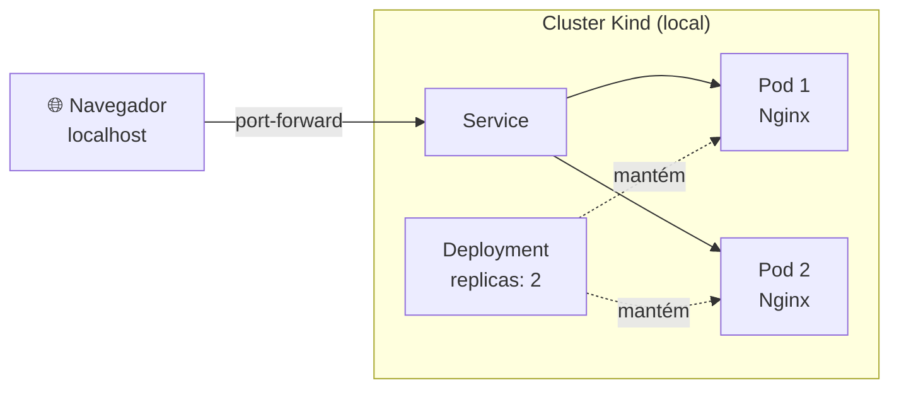
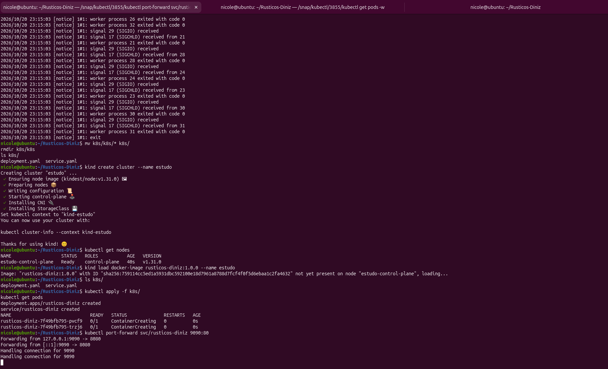
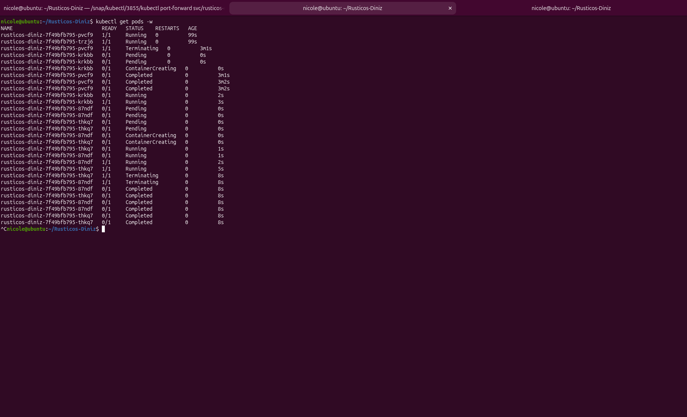

# ☸️ Kubernetes Fundamentals

Laboratório prático de **Docker e Kubernetes**: empacotei uma cópia local de um site real em uma imagem Nginx rodando sem root e a executei em um cluster **Kind** com Deployment, Service e duas réplicas, testando autorrecuperação e escalonamento.

## 💻 Sobre o projeto

Criei o site da **Rústicos Diniz** como presente para meus familiares. Ele continua publicado normalmente, sem Docker ou Kubernetes:
🌐 [rusticosdiniz.com.br](https://rusticosdiniz.com.br)

Para este laboratório, copiei os arquivos do site para o VS Code e usei essa cópia apenas para estudar, sem tocar no site original. Os arquivos do site **não estão neste repositório**, para não duplicar o conteúdo original.

## 🎯 Objetivo

Aprender como executar uma aplicação real em containers e orquestrá-la no Kubernetes, praticando:

- imagem Docker com Nginx executando **sem root**
- cluster local com **Kind**
- `Deployment` e `Service` em YAML
- acesso com `kubectl port-forward`
- autorrecuperação e escalonamento de Pods

## 🧰 Ambiente

- Linux (<!-- ex: Ubuntu 26.04 LTS -->)
- Docker Engine
- Kind e `kubectl` (<!-- versões -->)
- Nginx

## 🏗️ Arquitetura



## 🧠 Conceitos básicos

| Conceito | Descrição |
|----------|-----------|
| **Pod** | menor unidade do Kubernetes; aqui, um container Nginx com o site |
| **Deployment** | declara quantas réplicas devem existir e as recria se alguma sumir |
| **Service** | endereço estável que distribui o tráfego entre os Pods |
| **Kind** | Kubernetes local, em que os nós rodam como containers Docker |
| **Estado desejado** | o que o YAML declara; o Kubernetes trabalha para que a realidade coincida com ele |
| **`port-forward`** | encaminha uma porta local para um Service/Pod dentro do cluster |

## 🗂️ Estrutura do laboratório

```text
12-kubernetes-fundamentals/
├── Dockerfile            # imagem Nginx com o site, sem root
├── nginx.conf            # configuração do Nginx
├── .dockerignore
├── .gitignore
├── k8s/
│   ├── deployment.yaml   # 2 réplicas da aplicação
│   └── service.yaml      # exposição dos Pods
├── docs/img/             # evidências (screenshots)
└── README.md
```

## 📄 Arquivos do projeto

### `Dockerfile`

```dockerfile
# cole aqui o conteúdo real do seu Dockerfile
```

### `nginx.conf`

```nginx
# cole aqui o conteúdo real do seu nginx.conf
```

### `k8s/deployment.yaml`

```yaml
# cole aqui o conteúdo real do seu deployment.yaml
```

### `k8s/service.yaml`

```yaml
# cole aqui o conteúdo real do seu service.yaml
```

## 🛠️ Passo a passo

### 1. Construir e testar a imagem com Docker

```bash
docker build -t <nome-da-imagem>:<tag> .
docker run -d --name <nome-do-container> -p <porta-host>:<porta-container> <nome-da-imagem>:<tag>
```

O container executa como **usuário sem privilégios**, o que reduz o impacto de uma eventual falha de segurança. Acesse `http://localhost:<porta-host>` para confirmar que o site funciona antes de ir para o Kubernetes.


### 2. Criar o cluster, carregar a imagem e aplicar os manifestos

```bash
kind create cluster --name <nome-do-cluster>
kind load docker-image <nome-da-imagem>:<tag> --name <nome-do-cluster>
kubectl apply -f k8s/
kubectl get pods
kubectl get service
```

Os nós do Kind são containers, então **não enxergam as imagens do Docker da máquina**. Por isso a imagem é carregada no cluster com `kind load docker-image`.



### 3. Acessar o site

```bash
kubectl port-forward service/<nome-do-service> <porta-local>:<porta-do-service>
```

Abra `http://localhost:<porta-local>` no navegador. O tráfego entra pelo Service e chega a um dos dois Pods.

### 4. Testar a autorrecuperação

```bash
kubectl get pods
kubectl delete pod <nome-do-pod>
kubectl get pods
```

Logo após a exclusão, o Deployment cria um Pod novo (com outro nome) para voltar às 2 réplicas. O site continua disponível porque o outro Pod segue atendendo.



### 5. Alterar o número de réplicas

Escalonamento de **2 para 4** réplicas e de volta para **2**:

```bash
kubectl scale deployment <nome-do-deployment> --replicas=4
kubectl get pods
kubectl scale deployment <nome-do-deployment> --replicas=2
kubectl get pods
```

<!-- Se você alterou o número de réplicas pelo YAML ou por outro comando, troque o bloco acima -->


### 6. Estrutura no editor


## 🔍 Troubleshooting

Durante a configuração precisei corrigir alguns problemas, principalmente em torno de como a imagem chega ao Kind. Perguntas que o laboratório já permite responder:

| Pergunta | Comando | Onde olhar |
|----------|---------|-----------|
| Os Pods estão rodando? | `kubectl get pods` | coluna `STATUS` e `READY` |
| Quantas réplicas existem? | `kubectl get deployment` | coluna `READY` (ex.: `2/2`) |
| O Service existe e em qual porta? | `kubectl get service` | coluna `PORT(S)` |
| O cluster enxerga a imagem? | `kind load docker-image ...` | carregar a imagem no cluster após cada build |

<!-- Descreva aqui, em uma ou duas linhas, o problema real que você teve e como resolveu. É o que mais valoriza o README. -->

## 🧠 Aprendizados

- O Kubernetes trabalha com **estado desejado**: se um Pod é removido, o Deployment cria outro sem intervenção manual.
- Réplicas permitem manter o serviço no ar mesmo quando um Pod cai.
- No Kind, a imagem precisa ser **carregada no cluster**, porque os nós são containers separados do Docker da máquina.
- O `port-forward` dá acesso a um Service sem expor o cluster à rede.
- Rodar o container sem root é uma boa prática de segurança desde a imagem.
- Estudar com um projeto real, sem alterar o site no ar, permitiu testar sem risco.
